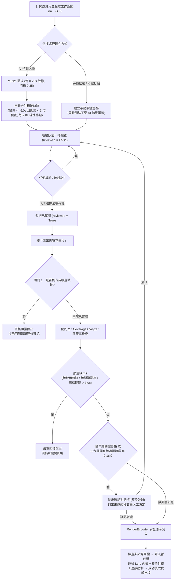
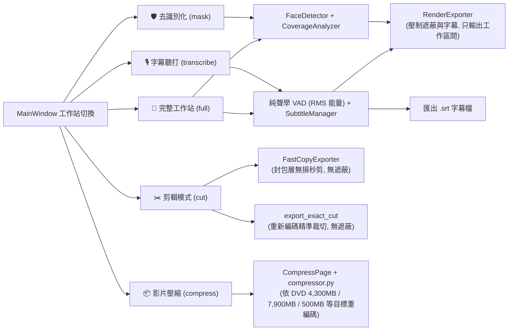

# 🏗️ 系統架構與模組設計 (ARCHITECTURE.md)

## 1. 模組分層拓撲

```text
[ GUI Layer (PySide6) ]
  ├── MainWindow (clipmask/gui/main_window.py)        <-- 五大工作模式切換與審核閘門
  ├── CompressPage (clipmask/gui/compress_page.py)    <-- 獨立影片容量壓縮工作頁 (v1.3.0)
  ├── VideoGraphicsView (clipmask/gui/video_view.py)  <-- 原生像素座標系與 Live Typing HUD
  ├── TimelineWidget (clipmask/gui/timeline.py)       <-- 雙軌 Pro 時間軸 + 懸浮縮圖 Popup
  └── MorandiStyles (clipmask/gui/styles.py)

[ Core Media & Decoding Engine ]
  ├── VideoSource (clipmask/media/source.py)          <-- PyAV 精確/快速解碼
  ├── ThumbnailExtractor (clipmask/media/source.py)   <-- 獨立輕量縮圖提取
  └── AudioExtractor (clipmask/media/audio.py)        <-- 音訊串流與能量擷取

[ AI & Signal Processing Modules ]
  ├── FaceDetector (clipmask/ai/detector.py)          <-- YuNet 0.35 多目標人臉追蹤 + 鄰近軌跡自動合併
  ├── MicroTracker (clipmask/track/tracker.py)        <-- CSRT 向後預測
  ├── TrackEvaluator (clipmask/track/evaluator.py)    <-- 關鍵影格 Lerp 內插與 Padding (上限 25%)
  ├── CoverageAnalyzer (clipmask/track/coverage.py)   <-- 匯出前覆蓋缺口與間隔檢查
  ├── VoiceActivityDetector (clipmask/ai/vad.py)      <-- 純聲學 RMS 能量 VAD
  └── SubtitleManager (clipmask/ai/subtitles.py)      <-- 繁中字卡繪製與 SRT 匯出

[ Export & Compression Pipelines ]
  ├── FastCopyExporter (clipmask/export/exporter.py)  <-- 純 PyAV 原生 Stream Copy (無遮蔽)
  ├── export_exact_cut (clipmask/export/exporter.py)  <-- 重新編碼精準裁切 (無遮蔽)
  ├── RenderExporter (clipmask/export/exporter.py)    <-- Single-pass 馬賽克/模糊/字卡壓制
  └── VideoCompressor (clipmask/export/compressor.py) <-- 依目標容量推算位元率與解析度 (v1.3.0)
```

## 2. 核心數據結構 (Models)

- `ProjectState`：包含 `SourceMetadata`、`WorkRange`、`List[Track]` 與字幕字典清單，支援完整 JSON 序列化。
- `Track`：由多顆 `Keyframe (time, pts, rect_px, source)` 組成，含 `enabled`、`reviewed`（任何編修會自動重設為 `False`）與 `auto_merged` 旗標。
- `SubtitleItem`：執行期資料類別，包含 `id`、`start_sec`、`end_sec`、`text`；寫入 `ProjectState` 時使用相容的字幕字典資料。

## 3. 核心安全與工作流圖解

### 去識別化安全流程與匯出閘門



### 五大工作模式與輸出路徑總覽


